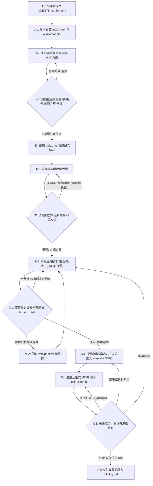

# 學校作業繳交報告｜用 LLM Wiki 做一份教學 HTML 簡報

> **繳交標題格式提醒**：`[學校簡稱] [學號] [系級簡稱] [姓名] 無人機間隔航測追蹤 LLM Wiki 與教學 HTML 簡報`
> *(請於繳交前補上你的學校、學號、系級、姓名，以及上傳後的 GitHub / 雲端連結)*

---

## 一、LLM Wiki 主題與簡短介紹

- **主題**：**考量定位不確定性之無人機間隔航測影像近即時移動物件追蹤與運動估計**（Near-Real-Time Moving Object Tracking and Motion Estimation from Interval UAV Photogrammetric Imagery Accounting for Geolocation Uncertainty）
- **簡短介紹**：
  本知識庫參考 Andrej Karpathy 的 **LLM Wiki** 三層架構（`raw/` 不可變原始來源層、`wiki/` 由 LLM 編譯維護的雙向連結知識層、`AGENTS.md` Schema 規範層），以「**先討論、後生成**」的方式與 Agent 共同確立目錄分類、命名規範（`FirstAuthorYYYY-ShortTitle`）、Obsidian `[[Wikilinks]]` 與 YAML Frontmatter 模板。
  知識庫收錄了 5 篇涵蓋「2D 外觀引導、局部特徵幾何、3D 世界座標投影、投影誤差橢圓與馬氏距離、相對地面動靜判斷」的 arXiv 論文 PDF，並進一步編譯為跨頁串聯的論文筆記、核心概念、代表方法、評測基準與跨論文總綜述，最後以此 Wiki 為唯一知識來源產出給零基礎讀者的教學型 HTML 簡報。

---

## 二、LLM Wiki 成果與連結

- **LLM Wiki 連結**：`[請填入你的 GitHub Repo 或雲端資料夾連結]`
- **知識庫規模總覽**（共 **5 篇原始論文 PDF** + **23 個 Wiki Markdown 檔案**）：
  - **Schema 規範**：`AGENTS.md`（含 Raw 來源規則、命名與模板、兩階段互動式 Ingest、Query、Lint 與簡報生成 Graph）
  - **原始來源層（`raw/`）**：
    - `raw/clips/Master-Research-Proposal.md`（研究規劃背景）
    - `raw/papers/` 共 5 篇 arXiv 論文 PDF：
      1. `Yang2024-SeaYouLater.pdf`（`arXiv:2311.03561`，WACV Workshops 2024）
      2. `Yi2024-UCMCTrack.pdf`（`arXiv:2312.08952`，AAAI 2024）
      3. `Liao2024-MoD2T.pdf`（`arXiv:2312.17641`，arXiv 2024）
      4. `Ma2026-AMOT.pdf`（`arXiv:2508.01730`，AAAI 2026）
      5. `Lindenberger2023-LightGlue.pdf`（`arXiv:2306.13643`，ICCV 2023）
  - **知識庫層（`wiki/`）**：
    - `wiki/papers/`（5 篇單篇論文筆記，皆含 `簡報可用亮點`）
    - `wiki/concepts/`（5 頁：`UAV-Multi-Object-Tracking`、`Geolocation-Uncertainty`、`Camera-Motion-Compensation`、`Motion-State-Estimation`、`Local-Feature-Matching`）
    - `wiki/methods/`（5 頁：`MG-MOT`、`UCMCTrack`、`MoD2T`、`AMOT`、`LightGlue`）
    - `wiki/benchmarks/`（4 頁：`SeaDronesSee`、`VisDrone`、`UAVDT`、`Motion-State-Benchmark`）
    - `wiki/syntheses/`（2 頁：`UAV-Tracking-Geolocation-Synthesis` 跨論文綜述、`Presentation-Script-UAV-Tracking` 14 頁簡報腳本）
    - `wiki/index.md`（總目錄）與 `wiki/log.md`（時間軸操作與檢查日誌）

---

## 三、教學型 HTML 簡報成果與 Wiki 對應

- **教學 HTML 簡報連結**：`[請填入 slides.html 的 GitHub Pages / 雲端連結]`（專案內檔案為 `slides.html`，搭配 `assets/` 內 3 張日式水彩版畫風插畫，支援離線瀏覽與鍵盤 `←` `→` / `G` 總覽互動）
- **教學設計特色**：採用日式文青雜誌風（和紙米白底、墨黑排版、低飽和朱紅／藍染／抹茶點綴），每頁均包含「生活化白話類比＋細線條 SVG 圖解＋右上角 Wiki 來源標註」，讓零基礎讀者也能從頭理解無人機間隔航測追蹤。
- **簡報與 Wiki 明確對應表（共 14 頁）**：

| 頁碼 | 簡報頁面標題 | 對應 Wiki 知識來源 |
| :---: | :--- | :--- |
| 01 | 封面：從高空看懂誰在動 | `[[UAV-Tracking-Geolocation-Synthesis]]` |
| 02 | 為什麼「間隔航測」比一般影片難追蹤？ | `[[UAV-Multi-Object-Tracking]]`, `Master-Research-Proposal` |
| 03 | 從 5 篇關鍵論文，一步步拼出完整解法 | `[[UAV-Tracking-Geolocation-Synthesis]]`, `wiki/index.md` |
| 04 | 拼圖一：AMOT 雙向外觀互驗（IDs -72.4%） | `[[Ma2026-AMOT]]`, `[[AMOT]]`, `[[VisDrone]]` |
| 05 | 拼圖二：LightGlue 局部特徵幾何（快 2.2×） | `[[Lindenberger2023-LightGlue]]`, `[[LightGlue]]`, `[[Local-Feature-Matching]]` |
| 06 | 拼圖三：MG-MOT 3D 世界座標投影（IDF1 85.9%） | `[[Yang2024-SeaYouLater]]`, `[[MG-MOT]]`, `[[SeaDronesSee]]` |
| 07 | 拼圖四：UCMCTrack 旋轉誤差橢圓（>1000 FPS） | `[[Yi2024-UCMCTrack]]`, `[[UCMCTrack]]`, `[[Camera-Motion-Compensation]]` |
| 08 | 拼圖五：MoD2T 動靜判斷（慢速 0.827 vs 快速 0.230） | `[[Liao2024-MoD2T]]`, `[[MoD2T]]`, `[[Motion-State-Benchmark]]`, `[[UAVDT]]` |
| 09 | 跨論文總對照：既有方法還缺了什麼？ | `[[UAV-Tracking-Geolocation-Synthesis]]` |
| 10 | 核心突破一：經校準的跨照片位移誤差模型（$S_{ij}$） | `[[Geolocation-Uncertainty]]`, `[[UAV-Tracking-Geolocation-Synthesis]]` |
| 11 | 核心突破二：三態動靜推論與啟停 ID 維持 | `[[Motion-State-Estimation]]`, `[[Geolocation-Uncertainty]]` |
| 12 | 核心突破三：觀測機會與有限延遲近即時確認 | `[[UAV-Tracking-Geolocation-Synthesis]]`, `Master-Research-Proposal` |
| 13 | 帶走這三個核心觀念（＋5 篇論文來源清單） | 全部 5 篇 `wiki/papers/` |
| 14 | 附錄：本簡報的 LLM Wiki 與 Graph 製作流程 | `AGENTS.md`, `wiki/index.md`, `wiki/log.md` |

---

## 四、Loop / Graph 流程設計說明

### 4.1 整體流程圖（Phase A 知識累積層 → Phase B 簡報生成 Graph）

### 4.2 流程設計核心說明
1. **哪些步驟會重複執行（Loops）？**
   - **`A2 ↔ Lint` 知識庫維護迴圈**：每吸收新論文或更新頁面後，執行腳本檢查所有 `[[Wikilinks]]`、孤立頁與跨論文矛盾，有問題即回修並重測。
   - **`N1 ↔ G1` 大綱對齊迴圈**：反覆確認教學順序、零基礎可讀性與頁數，直到大綱定案才寫內文。
   - **`N2 ↔ N2A ↔ G2` 事實與密度迴圈**：若文案中的實驗數據無法對應到 `wiki/papers/`，觸發 `N2A` 回查補證；若單頁文字過密或過於學術，回到 `N2` 精簡並補上生活類比。
   - **`N4 / N3 / N2 ↔ G3` 精準回退迴圈**：依錯誤類型決定回退深度——純 HTML/CSS 問題只回退 `N4`，圖表問題回退 `N3`，避免整份簡報打掉重做。
2. **為什麼這樣設計？**
   - **知識層與呈現層分離**：讓 LLM 在 `N0–N2` 專心處理事實準確度與教學敘事，在 `N3–N4` 專心處理日式文青美學與前端程式碼，避免一次生成整份 HTML 時顧此失彼。
   - **檢查往前移（Shift-Left）**：在文字大綱（`G1`）與腳本（`G2`）階段就先攔截結構錯誤與數據幻覺，修改成本遠低於進到 HTML/SVG 排版後才大幅返工。

---

## 五、實際執行結果與檢查紀錄（摘自 `wiki/log.md`）

1. **知識庫 `Lint` 檢查紀錄（2026-11-23）**：
   - 針對 `wiki/` 下 22 個初始檔案執行自動化連結與孤立頁掃描：結果為 **斷裂 `[[Wikilinks]]` = 0、孤立頁 = 0**，並成功標註兩處跨論文實證衝突（`Camera-Motion-Compensation` 在 MOT17 加分但在 KITTI 低幀率劇烈運動倒退；外觀特徵在密集城市空拍有效但在海面微目標失效）。
2. **`Gate G1` 人工審核調整紀錄**：
   - 初版大綱規劃 13 頁主題教學，經 `G1` 審核後決定新增第 14 頁「附錄：本簡報的 LLM Wiki 與 Graph 製作流程」，定案為 14 頁。
3. **`Gate G2` 事實與密度檢核紀錄**：
   - 將 14 頁腳本存為 `wiki/syntheses/Presentation-Script-UAV-Tracking.md`，逐項回查 5 篇 `wiki/papers/` 核實所有核心數據（如 `AMOT` IDs 減 72.4%、`LightGlue` 31.4 ms、`MG-MOT` IDF1 85.9%、`UCMCTrack` >1000 FPS、`MoD2T` 0.827 vs. 0.230），並確認每頁控制在 3～4 個精簡要點與 1 個生活類比，通過人工確認。
4. **`Gate G3` 實機檢查抓錯與 `G3 → N4` 回退修正紀錄**：
   - 自動化檢核 `slides.html` 時，實際抓出兩個問題：
     1. **8 處 Markdown/LaTeX 語法殘留**：從 `N2` Markdown 腳本轉寫進 `N4` 純 HTML 時，殘留了 `$S_{ij}$`、`$C_{ij}$`、`$\mathbf{D}_f + \mathbf{D}_b$` 與反引號 `` `IoU = 0` ``，未載入 KaTeX 時會在網頁直接印出原始符號。
     2. **2 處跨 SVG `<defs>` 箭頭依賴**：Slide 08 與 Slide 14 的 SVG 箭頭引用了 Slide 04 內的 `<defs>`，在獨立渲染或列印時具失效風險。
   - **回退修正結果**：觸發 `G3 → N4` 回退，將 8 處公式與行內程式碼改寫為標準 HTML 標籤（`<i>`/``/``/`<code>`），並於 Slide 08 與 Slide 14 補齊獨立 `<defs>`；重跑檢核後確認 **14 頁完整、殘留語法 `0`、引用 `assets/` 圖檔 3 張全數存在（缺圖 `0`）**。

---

## 六、反思（Reflection）

### 1. 哪一個節點最常出錯？
本次實際執行中，最容易出錯的節點有兩個：
- **最常出錯：`N4`（從 Markdown 腳本轉譯為 HTML 簡報的跨格式轉換節點）**。LLM 在撰寫 Markdown Wiki 時習慣使用 LaTeX（`$...$`）與反引號（`` `...` ``），進入 `N4` 生成純 HTML 時極易不自覺把這些語法直接帶入 HTML 內文（本次就抓出 8 處），以及在多個 inline SVG 間共用 `<defs>` ID 造成隱性依賴。
- **次常出錯：`A2`（原始論文 PDF 深度閱讀與數據抽取）**。學術 PDF 本身偶爾存在前後表格微差或引用筆誤（如 `Liao2024-MoD2T` 論文未揭露部分超參數且附錄文獻誤引），若沒有逐頁核對與記錄批判區，後續寫進簡報容易產生誤導。

### 2. 發現問題後，把檢查往前移到了哪一個步驟？
- **把「內容結構與受眾難度檢查」往前移至 `G1`（大綱階段）**，以及**把「數據真實性、白話類比與單頁字數密度檢查」往前移至 `G2`（逐頁腳本階段）**，避免進到 HTML 才發現某頁太難或數據不對而重改版面。
- **把「跨格式語法殘留與圖檔路徑檢查」自動化納入 `G3` 檢核腳本**（用正規表達式掃描 `$`、`` ` `` 與 `assets/` 存在性），不再只靠肉眼抽看。

### 3. 有沒有因此修改 Workflow / Graph？為什麼？
- **有！我們實際修訂了專案核心 Schema（`AGENTS.md`）**：
  - 原本的 `AGENTS.md` 只規範了 Wiki 的 `Ingest / Query / Lint` 三大工作流；在規劃簡報階段時，我們正式新增了 **第 6.4 節 `Presentation（教學型 HTML 簡報生成 Graph）`**，將「`N0 → N1 → G1 → N2 → (N2A) → G2 → N3 → N4 → G3 → N5`」固化進系統規範。
  - **原因**：把檢查關卡與精準回退路徑明文寫入 Schema 後，不只本次作業大幅減少返工，未來若要從同一份論文 Wiki 產出不同主題（如碩士口試簡報或實驗室讀書會簡報），Agent 都能自動遵循同樣的「先對齊、再補證、最後自動化檢查 HTML」流程，確保知識與簡報品質穩定一致。
